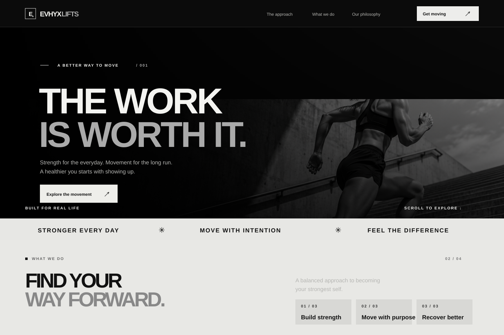
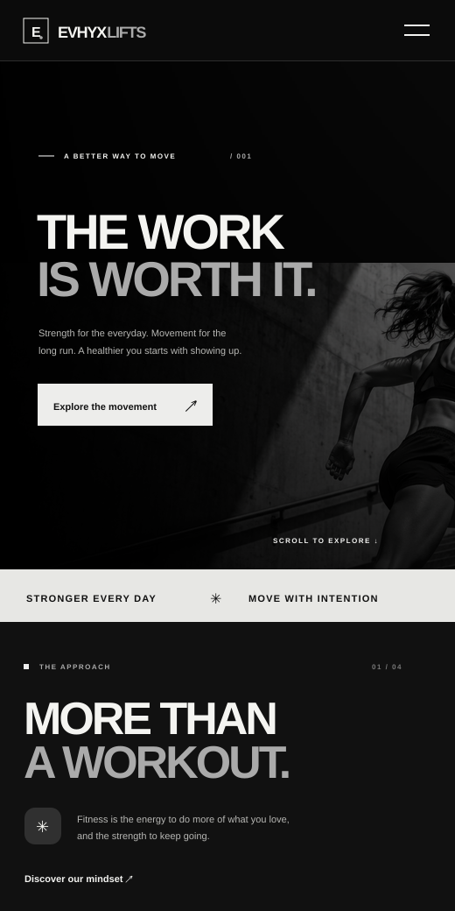

# EVHYXLIFTS

### Move well. Live fully.

An editorial fitness landing experience built around sustainable strength, intentional movement, and recovery. EvhyxLifts is designed to feel direct, calm, and motivating on every screen.

<p align="center">
  
</p>

<p align="center">
  
</p>

## The experience

- A high-impact, image-led hero with a clear movement-focused call to action.
- Responsive navigation that becomes a compact menu on smaller screens.
- Four editorial sections: approach, programs, philosophy, and next move.
- Three program pillars: build strength, move with purpose, and recover better.
- Smooth section reveals, parallax imagery, a continuous ticker, and reduced-motion support.
- A focused member sign-in dialog launched from the header.

## Run it locally

### Frontend

```bash
cd client
npm install
npm run dev
```

Vite will print the local address in the terminal (normally `http://localhost:5173`).

### API server

```bash
cd Server
npm install
npm start
```

The Express server runs at `http://localhost:8000`.

## Available commands

| Command | Purpose |
| --- | --- |
| `cd client && npm run dev` | Start the frontend development server with hot reload. |
| `cd client && npm run build` | Create an optimized frontend build in `client/dist/`. |
| `cd client && npm run preview` | Serve the frontend production build locally. |
| `cd client && npm run lint` | Check the frontend with ESLint. |
| `cd Server && npm start` | Start the Express API server. |

## Project structure

```text
.
├── client/                  # React and Vite frontend
│   ├── public/readme/       # README preview images
│   └── src/
│       ├── assets/          # Landing-page photography
│       ├── components/styles/ # Home page styling and responsive rules
│       ├── App.jsx          # Page content and interactive behavior
│       ├── index.css        # Global styles and typography
│       └── main.jsx         # React entry point
├── Server/                  # Express API server
├── postman/                 # Postman collection and workspace files
└── README.md
```

## Built with

The frontend uses React 19, Vite, and hand-crafted responsive CSS. It includes semantic landmarks, descriptive image alt text, keyboard-dismissable dialog behavior, and a `prefers-reduced-motion` fallback. The API server uses Express.

---

**EVHYXLIFTS** — *The work is worth it.*
