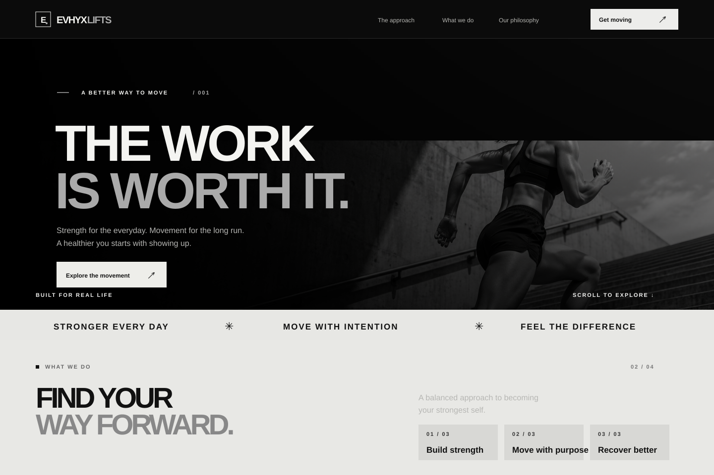
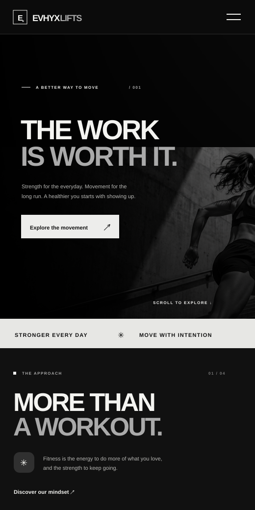

# EVHYXLIFTS

### Move well. Live fully.

An editorial fitness landing experience built around sustainable strength, intentional movement, and recovery. EvhyxLifts is designed to feel direct, calm, and motivating on every screen.

<p align="center">
  
</p>

<p align="center">
  
</p>

## The experience

- A high-impact, image-led hero with a clear movement-focused call to action.
- Responsive navigation that becomes a compact menu on smaller screens.
- Four editorial sections: approach, programs, philosophy, and next move.
- Three program pillars: build strength, move with purpose, and recover better.
- Smooth section reveals, parallax imagery, a continuous ticker, and reduced-motion support.
- A focused member sign-in dialog launched from the header.

## Run it locally

```bash
cd client
npm install
npm run dev
```

Vite will print the local address in the terminal (normally `http://localhost:5173`).

## Available commands

| Command | Purpose |
| --- | --- |
| `npm run dev` | Start the local development server with hot reload. |
| `npm run build` | Create an optimized production build in `dist/`. |
| `npm run preview` | Serve the production build locally. |
| `npm run lint` | Check the frontend with ESLint. |

## Frontend structure

```text
client/
├── public/                 # Browser-served assets and README previews
├── src/
│   ├── assets/             # Landing-page photography
│   ├── components/styles/  # Home page styling and responsive rules
│   ├── App.jsx             # Page content and interactive behavior
│   ├── index.css           # Global styles and typography
│   └── main.jsx            # React entry point
└── vite.config.js          # Vite configuration
```

## Built with

React 19, Vite, and hand-crafted responsive CSS. The site uses semantic landmarks, descriptive image alt text, keyboard-dismissable dialog behavior, and a `prefers-reduced-motion` fallback.

---

**EVHYXLIFTS** — *The work is worth it.*
